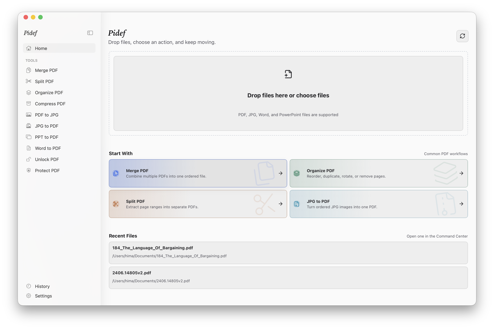
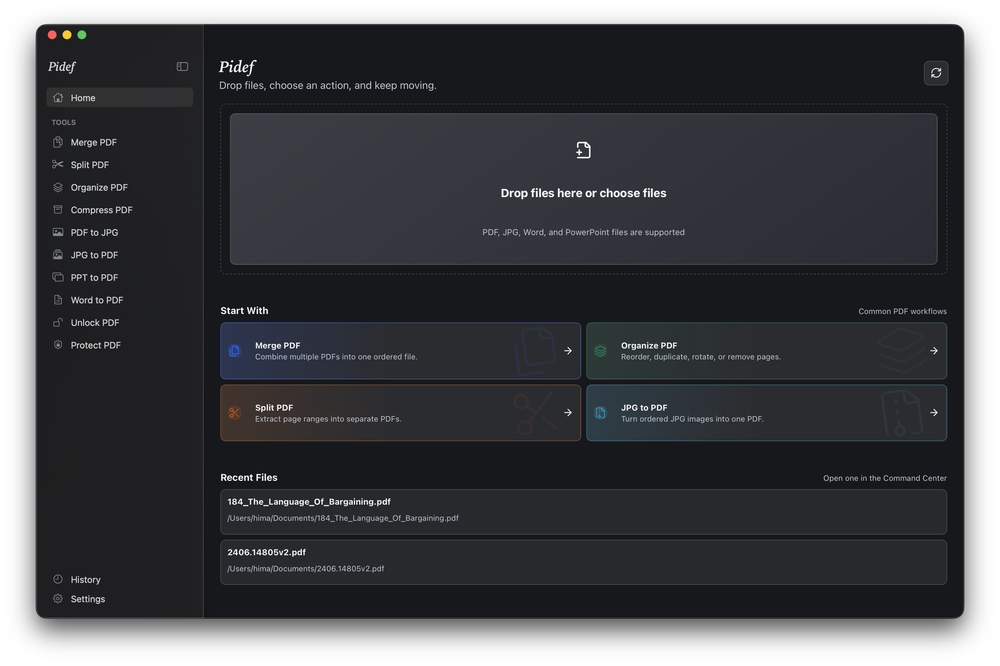

# Pidef

Pidef is a local-first desktop PDF utility for macOS, Windows, and Linux. It is built to keep common document workflows on your machine: merge PDFs, split pages, organize pages visually, convert PDFs and images, and protect or unlock documents when you have the password.

The app is built with Tauri, Vite, React, TypeScript, and Rust. The Rust operation layer is designed so a future CLI or MCP tool can reuse the same core PDF APIs.

> Development status: Pidef is actively in development. The current app is usable for early testing, but it still needs more polish, broader fixture testing, and platform QA. Compression and the in-house image optimizer are in place; Office conversion (Word/PPT) was deliberately cut.

## Screenshots

### Command Center





## What Pidef Does

- Starts with a Command Center for dropping or choosing files.
- Suggests the most relevant actions based on selected file types.
- Shows PDF thumbnails and previews where they help the workflow.
- Organizes PDFs with page thumbnails, reordering, rotate, delete, and duplicate actions.
- Saves generated outputs through desktop Save As dialogs instead of forcing an output folder.
- Keeps recent files and activity history local to the app.
- Uses a native-feeling macOS shell with a collapsible sidebar.

## Current Feature Status

| Feature | Status |
| --- | --- |
| Merge PDF | Available through bundled/detected `qpdf` |
| Split PDF | Available through bundled/detected `qpdf` |
| Organize PDF | Available through bundled/detected `qpdf` |
| PDF thumbnails and previews | Available through bundled/detected PDFium |
| PDF to JPG | Available through bundled/detected PDFium |
| JPG to PDF | Available through Rust image/PDF generation |
| Unlock PDF | Available through bundled/detected `qpdf` |
| Protect PDF | Available through bundled/detected `qpdf` |
| Compress PDF | Available; lossless and image-optimizing presets via qpdf + in-house optimizer |

## Architecture

Pidef is structured as a Tauri desktop shell over a reusable Rust core:

- `src/`: React and TypeScript UI.
- `src-tauri/`: Tauri commands, packaging, native shell integration, and bundled resources.
- `crates/pdf_tool_core/`: shared operation models, validation, dependency detection, previews, and conversion orchestration.

The Tauri command layer is intentionally thin. Core operation models, validation, dependency detection, and conversion orchestration live in `pdf_tool_core` so the same code can later back a CLI, MCP server, or other local automation surface.

## Runtime Dependencies

Pidef checks bundled resources first, then system paths.

- Bundled/detected `qpdf` powers merge, split, organize, unlock, and protect.
- Bundled/detected PDFium powers PDF previews and PDF-to-JPG rendering.
- Ghostscript is not part of the current plan. Compression will be revisited separately.

## Local Development

Install JavaScript dependencies, then run the desktop app:

```sh
npm install
npm run tauri dev
```

Run the frontend checks:

```sh
npm run build
npm test
```

Run the Rust check:

```sh
cargo check --manifest-path src-tauri/Cargo.toml
```

## Desktop Builds

Build a standalone desktop app for your current platform:

```sh
npm run tauri build -- --bundles app
```

On macOS, the app bundle is written to:

```sh
target/release/bundle/macos/Pidef.app
```

Open the app bundle for normal desktop behavior:

```sh
open "target/release/bundle/macos/Pidef.app"
```

A raw executable is also available at:

```sh
target/release/pidef
```

Running the raw executable directly can keep a terminal window attached. Use the `.app` bundle for the intended desktop experience.

To build platform installers/packages, run:

```sh
npm run tauri build
```

Bundles are created under `target/release/bundle`. On macOS, the app bundle build works in the normal development flow; the optional DMG wrapper may need a non-sandboxed packaging environment.

## Roadmap

- Improve release readiness and platform QA across macOS, Windows, and Linux.
- Finish compression research and add a local compression implementation.
- Expand fixture coverage for every operation.
- Polish organize/split previews and larger-document performance.
- Add a future CLI/MCP layer over the shared Rust operation APIs.
